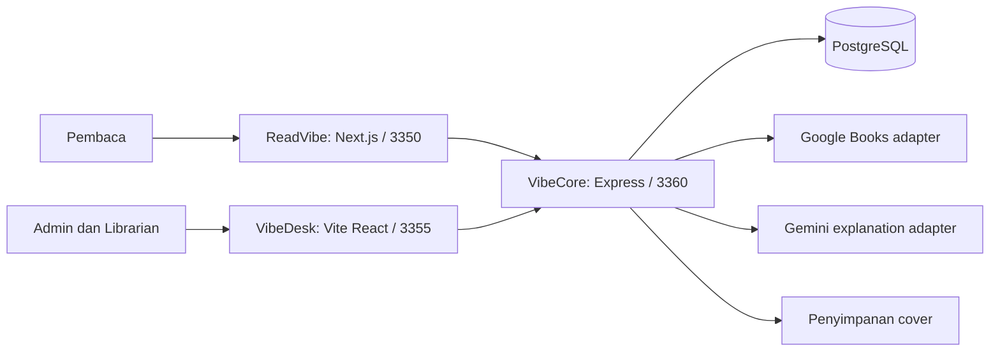

# Arsitektur Ekosistem ReadVibe

Referensi source pada 17 November 2026. Setup lokal tersedia di [README utama](../../README.md).

## Komponen dan koneksi

| Komponen | Struktur dan tanggung jawab |
| --- | --- |
| ReadVibe | Next.js App Router, Redux Toolkit, Bootstrap; UI pembaca dan aktivitas personal |
| VibeDesk | React Router 7, Redux Toolkit, Axios, Bootstrap; 31 route CMS dan state request |
| VibeCore | Express, Sequelize, PostgreSQL; autentikasi, aturan bisnis, data, dan integrasi |

Setiap aplikasi memiliki package.json dan environment sendiri. Tidak ada npm workspace atau script root. Komunikasi data antaraplikasi memakai REST API; ilustrasi VibeDesk tertentu diimpor dari folder bersama `Assets/illustrations` saat build.

## Struktur implementasi

Backend mengikuti `routes → validator → controller → service → Sequelize model` untuk payload yang memiliki validator. Middleware authentication dan authorization berjalan sebelum operasi staf. Tidak semua endpoint memiliki validator tersendiri; lihat [router modul](../../vibecore/src/modules/) untuk implementasi aktual.

Frontend VibeDesk membagi tanggung jawab ke `app/routes`, `app/provider`, `app/store`, `features`, `pages`, `components`, `hooks`, `services`, `helpers`, `constants`, dan `styles`. Axios terpusat menangani token dan error. Redux menangani workspace serta operasi buku; hook query menyediakan data/loading/error, retry, dan pembatalan request. Tidak memakai TanStack Query.

## Environment dan batas kepercayaan

- ReadVibe memakai `NEXT_PUBLIC_API_URL`; VibeDesk memakai `VITE_API_URL`. URL menunjuk backend, contohnya `http://localhost:3360`.
- Backend default CORS menerima origin `http://localhost:3350` dan `http://localhost:3355`; deployment harus menetapkan origin yang sesuai.
- JWT_SECRET, kredensial PostgreSQL, Google Books key, dan Gemini key hanya berada di backend. Middleware membaca role/status aktual dari database, bukan mempercayai role token saja.
- CMS hanya menerima Admin/Librarian. Pengelolaan member, staf, dan settings dibatasi untuk Admin pada API maupun UI. Rincian: [matriks akses](../security/matriks-hak-akses.md).
- Database mengikuti DB_NAME dan DB_PORT environment; jangan menganggap nama atau port pada contoh sebagai konfigurasi aktif.

## Integrasi dan persistence

Google Books menyediakan pencarian metadata melalui adapter backend. Wizard menyimpan hasil yang sudah dipetakan melalui endpoint buku biasa; tidak ada endpoint import khusus. Rekomendasi diperingkat oleh ranker lokal dengan settings tersimpan. Gemini hanya menghasilkan penjelasan jika fitur diaktifkan dan server dikonfigurasi.

Settings berada di `application_settings`; audit keputusan moderasi berada di `reading_activities`. Cover divalidasi dan dikonversi ke WebP, lalu disimpan pada direktori backend yang harus persisten ketika deployment. Upload dan penyimpanan record buku adalah operasi terpisah; cleanup cover yang tidak terpakai belum otomatis.

Lihat [model data](../backend/spesifikasi-api-dan-data.md), [API](../backend/api-specification.md), dan [README backend](../../vibecore/README.md) untuk kontrak rinci.
