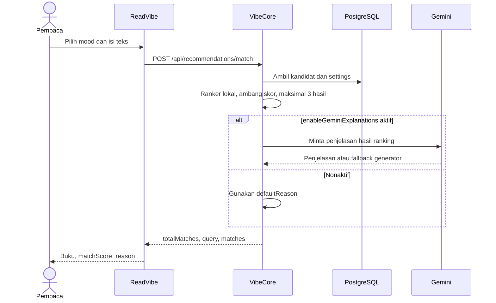
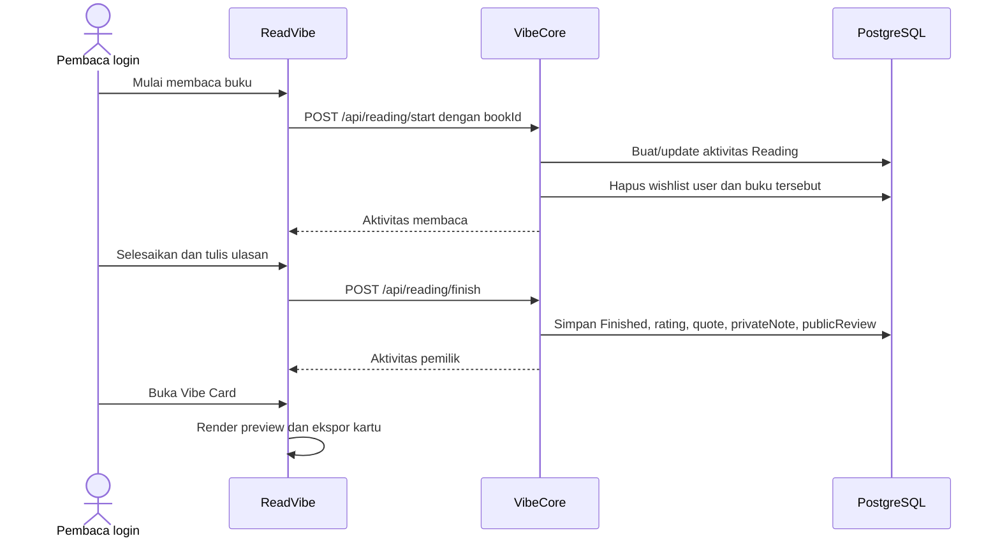
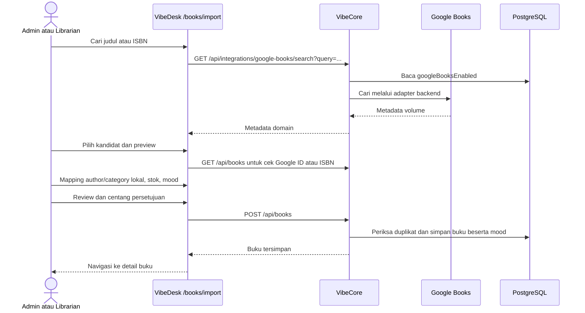
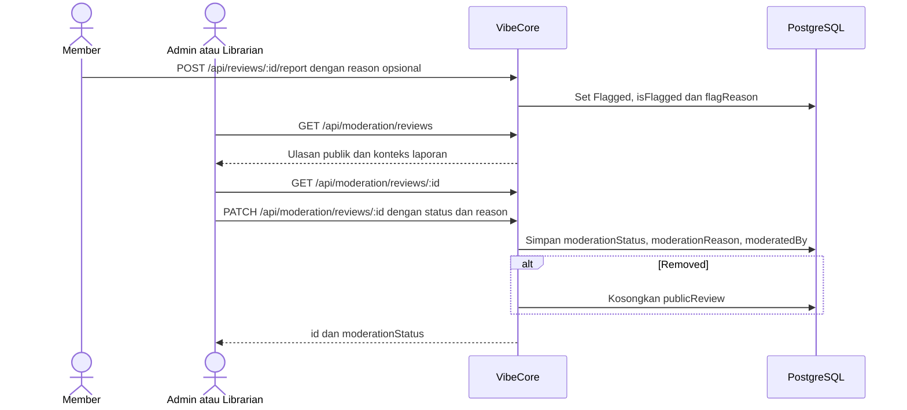

# Alur Pengguna

Ditinjau dari router dan service pada 17 November 2026. Diagram menjelaskan implementasi backend dan alur CMS; bukan rekaman pengujian live. Daftar endpoint ada di [spesifikasi API](../backend/api-specification.md).

## Rekomendasi mood

Skor ranking memakai rentang 0–98; settings numerik memakai 0–1. Gemini bukan pengganti ranker lokal. Kandidat kosong menghasilkan daftar hasil kosong.

## Wishlist, membaca, dan Vibe Card

Backend juga menyediakan `GET /api/reading/vibe-card/:id` untuk data kartu publik pada aktivitas Finished, tanpa privateNote. UI dapat membangun kartu dari data yang sudah dimuat; diagram tidak mengklaim setiap preview memanggil endpoint kartu. Start/finish menerima bookId dan dapat membuat atau memperbarui aktivitas; tidak ada endpoint move-to-reading khusus atau jaminan state machine ketat pada seluruh update.

## Wizard import VibeDesk

Duplikat diblokir pada wizard dan diperiksa kembali saat create. Author/category yang belum ada dibuat melalui halaman katalog terkait. API key tetap di backend. Wizard memiliki empat tahap; bukan modal atau import satu klik. Kegagalan provider dikembalikan sebagai error, bukan daftar sukses kosong.

## Laporan dan moderasi

Keputusan menerima Approved, Rejected, Flagged, atau Removed. Reason wajib; catatan privat pemilik tidak masuk konteks moderasi dan tidak dihapus oleh Removed. Halaman CMS memakai `/moderation` dan `/moderation/:id`.
