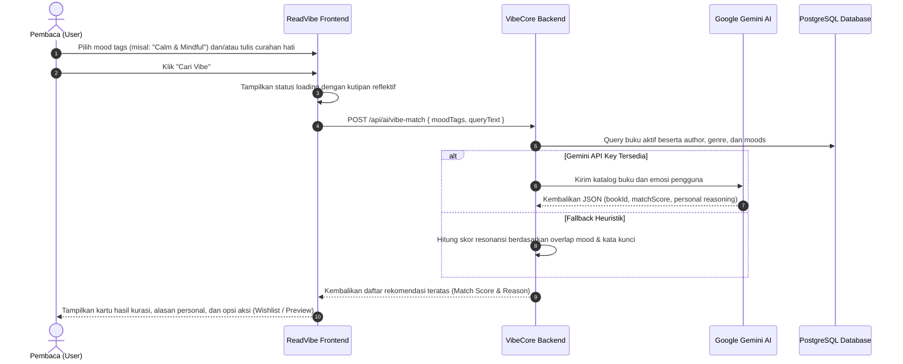
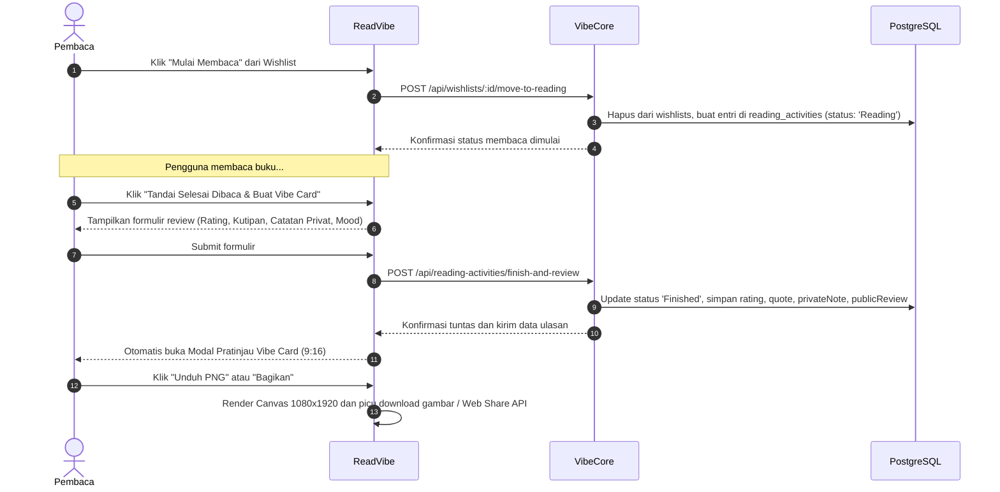
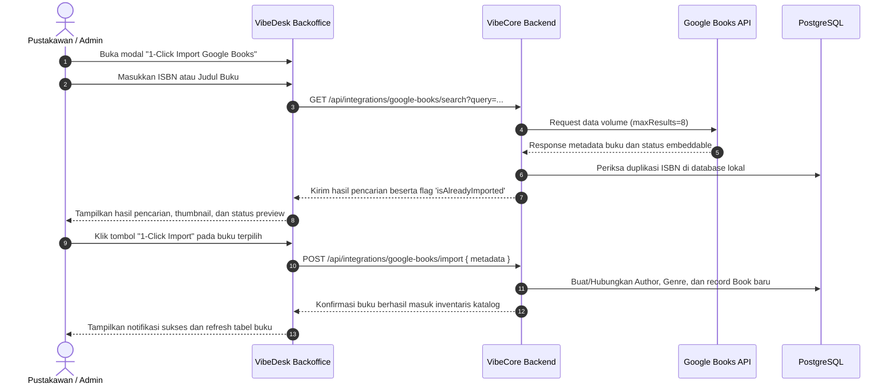
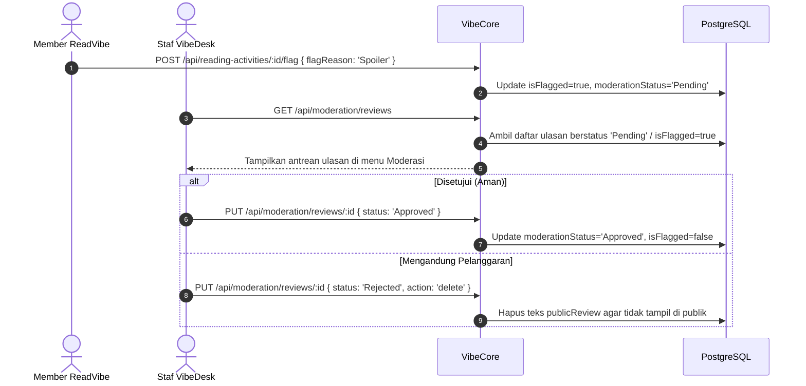

# Alur Pengguna (User Flows)

---

## 1. Alur AI Vibe Matching (ReadVibe)

---

## 2. Alur Transisi Status Membaca & Pembuatan Vibe Card (9:16)

---

## 3. Alur 1-Click Import Google Books (VibeDesk)

---

## 4. Alur Moderasi Ulasan Komunitas

